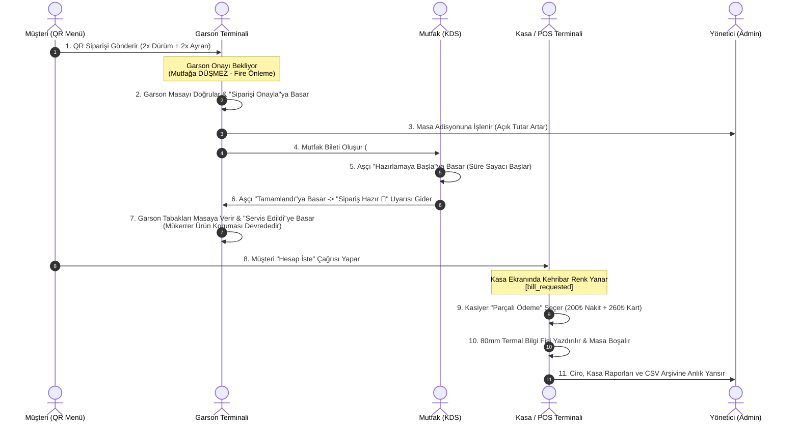

# 🥙 Ali Baba Döner Kafe — Entegre Restoran & Kafe Otomasyon Ekosistemi

[](https://nodejs.org/)
[](https://expressjs.com/)
[](https://developer.mozilla.org/en-US/docs/Web/JavaScript)
[-FF6B6B?style=for-the-badge)](https://developer.mozilla.org/en-US/docs/Web/API/Server-sent_events)
[](./test_compatibility.js)
[](./package.json)

Ali Baba Döner Kafe; modern yeme-içme işletmeleri (döner kafe, restoran, bistro ve paket servis noktaları) için tasarlanmış, harici ağır kütüphane bağımlılığı bulunmayan (Vanilla JS + CSS3), hafif, yüksek performanslı ve tam teşekküllü bir **Restoran Yönetim ve Otomasyon Ekosistemi**'dir.

Müşteri masa siparişinden mutfak hazırlığına, garson terminalinden kasa tahsilatına (parçalı ödeme) ve yönetici finansal raporlarına kadar restoran operasyonunun tüm adımları **Server-Sent Events (SSE)** ile gerçek zamanlı olarak birbirine bağlıdır.

---

## 📌 İçindekiler
- [Ekosistem Mimarisi ve 5 Temel Modül](#-ekosistem-mimarisi-ve-5-temel-modül)
  - [1. Müşteri QR Menü & Sipariş](#1-müşteri-qr-menü--sipariş-)
  - [2. Garson Terminali](#2-garson-terminali-garson)
  - [3. Mutfak Ekranı - KDS](#3-mutfak-ekranı---kds-mutfak)
  - [4. Kasa & POS Terminali](#4-kasa--pos-terminali-kasa)
  - [5. Yönetici (Admin) Portalı](#5-yönetici-admin-portalı-admin)
- [Uçtan Uca Sipariş ve İş Akış Şeması](#-uçtan-uca-sipariş-ve-iş-akış-şeması)
- [Öne Çıkan Kritik İş Kuralları ve Güvenlik](#-öne-çıkan-kritik-iş-kuralları-ve-güvenlik)
- [Teknoloji Yığını](#-teknoloji-yığını)
- [Kurulum ve Çalıştırma](#-kurulum-ve-çalıştırma)
- [Varsayılan Giriş Bilgileri ve PIN Kodları](#-varsayılan-giriş-bilgileri-ve-pin-kodları)
- [REST API ve SSE Olayları](#-rest-api-ve-sse-olayları)
- [Otomatik Test Süreçleri (76/76 Test)](#-otomatik-test-süreçleri-7676-test)
- [Proje Dizin Yapısı](#-proje-dizin-yapısı)
- [Lisans](#-lisans)

---

## 🏗️ Ekosistem Mimarisi ve 5 Temel Modül

```
+-----------------------------------------------------------------------------------+
|                        Ali Baba Döner Kafe Ekosistemi                             |
+-----------------------------------------------------------------------------------+
       |                       |                    |                   |
       v                       v                    v                   v
[📱 Müşteri QR Menü]   [🧑‍🍳 Garson Terminali]  [🍳 Mutfak KDS]   [💳 Kasa / POS]
       |                       |                    |                   |
       +-----------------------+--------------------+-------------------+
                                         |
                                         v
                         [⚡ Express 5 Backend & SSE Hub]
                                         |
                                         v
                        [📊 Yönetici / Admin Portalı]
```

### 1. Müşteri QR Menü & Sipariş (`/`)
* **Masa Bazlı Deneyim:** Masadaki QR kod okutulduğunda `/?masa=4` parametresiyle masa numarası otomatik algılanır.
* **Zengin Menü & Gramaj Seçimi:** Döner çeşitleri, porsiyon alternatifleri (100g, 150g, 200g, Dürüm, Tombik, Ekmek Arası, İskender), meşrubatlar ve tatlılar.
* **Akıllı Arama ve Filtreleme:** Kategori sekmeleri ve canlı ürün arama motoru.
* **Sepet ve Özel Notlar:** Sepete ürün ekleme, adet belirleme ve mutfağa özel not iletme (*"Soğansız, bol soslu"*).
* **Masa Çağrı Butonları:** Garson çağırma ve hesap isteme sinyalleri.

### 2. Garson Terminali (`/garson`)
* **Mobil Öncelikli Tasarım:** Akıllı telefon ve el terminallerine %100 uyumlu, dokunmatik optimize arayüz.
* **Canlı Masa Grid'i:** Masaların durumu anlık renk kodlarıyla izlenir:
  * ⚪ **Boş Masa (Idle):** Açık siparişi bulunmayan masalar.
  * 🟢 **Açık Adisyon (Occupied):** Masada aktif sipariş var ve toplam tutar canlı güncellenir.
  * 🔔 **Çağrı Bekliyor:** Müşteri garson çağırdığında veya sipariş verdiğinde yanıp sönen uyarı.
* **Hızlı Adisyona Ürün Ekleme:** Kategori menüsünden tek dokunuşla adisyona ürün ekleme, miktar (+ / -) artırma ve hızlı not çipleri (*"Az Pişmiş"*, *"Acılı"* vb.).
* **Masa Taşıma ve Birleştirme:** Müşteri masa değiştirdiğinde tek tıkla adisyonu hedef masaya aktarma (`Masa Taşı`).
* **Sipariş Onay Mekanizması:** Müşterinin masadan verdiği QR siparişi garson tarafından doğrulanmadan mutfağa iletilmez.
* **Servis Hazır Bildirim Yönetimi:** Mutfakta hazır olan tabaklar garson ekranına yeşil servis uyarısı olarak düşer. Garson siparişi masaya servis ettiğinde *"Servis Edildi / Kapat"* butonuna basar; adisyona mükerrer ürün eklenmesi engellenir.

### 3. Mutfak Ekranı - KDS (`/mutfak`)
* **Biletleme Sistemi:** `#101`, `#102` formatında sıralı mutfak fişleri.
* **Süre Sayaçları ve Renk Uyarıları:**
  * 🟢 **Normal (0 - 5 dk):** Yeni gelen siparişler.
  * 🟡 **Dikkat (5 - 10 dk):** Hazırlığı devam eden siparişler.
  * 🔴 **Gecikme (> 10 dk):** Kritik uyarı seviyesine ulaşan siparişler.
* **Hazırlık İş Akışı:**
  * Aşçı *"Hazırlamaya Başla"* butonuna bastığında sipariş `preparing` durumuna geçer ve hazırlık süresi saymaya başlar.
  * Ürün bazlı interaktif onay kutuları (checkbox) ile hazırlanan tabaklar tek tek işaretlenir.
  * *"Tamamlandı"* butonuna basıldığında sipariş tamamlanır ve Garson Terminali'ne anlık sesli zil ile *"Servise Hazır"* bildirimi gönderilir.
  * Hatalı basımlarda *"Geri Al (Undo)"* imkanı.
* **Web Audio API:** Harici MP3 dosyası gerektirmeyen, tarayıcı tabanlı sentezlenmiş mutfak zil sesi (test butonu dahil).

### 4. Kasa & POS Terminali (`/kasa`)
* **Canlı Salon Paneli:** Masaların açık adisyon tutarları, geçen süre ve hesap isteme uyarıları (`bill_requested`).
* **Finansal Hesaplama:** Ara toplam, %10 KDV dökümü, dinamik iskonto (%5, %10, %15) ve para yuvarlama.
* **Nakit Para Üstü Çekmecesi:** Alınan nakit tutarına göre (50₺, 100₺, 200₺, 500₺ hızlı butonlar) anlık para üstü hesaplama.
* **Çoklu ve Parçalı Ödeme (Split Payment):**
  * Nakit Tahsilat
  * Kredi Kartı / POS
  * Yemek Kartı (Multinet / Sodexo)
  * **Parçalı Ödeme:** Bir adisyonun tutarını aynı anda hem Nakit hem Kredi Kartı ile bölerek kapatabilme ve matematiksel bakiye kontrolü.
* **Termal Fiş Simülatörü:** 80mm standart POS termal yazıcı formatında gerçekçi kağıt önizlemesi ve doğrudan yazdırma (`Ctrl+P` optimize).
* **Z Raporu ve Günlük Özet:** Gün sonu toplam ciro, nakit/kart oranları ve geçmiş adisyon dökümleri.

### 5. Yönetici (Admin) Portalı (`/admin`)
* **Canlı Finansal Dashboard:**
  * 💰 Bugünkü Toplam Ciro
  * 🧾 Kapanan Sipariş Adedi
  * 🪑 Masalardaki Açık Tutar (Bekleyen Alacak)
  * ⏱️ Ortalama Mutfak Hazırlık Süresi
  * 🏆 **En Çok Satan 5 Lezzet** pasta/bar grafiği
* **Ciro & Raporlar Sekmesi:**
  * Tarih aralıklı filtreleme (Bugün, Dün, Son 7 Gün, Bu Ay).
  * Tüm kapanmış adisyonların dökümü, ödeme yöntemi kırılımı ve toplam iskonto analizi.
  * **Excel / CSV Dışa Aktarma:** Türkçe karakter (`₺, ş, ğ, ı, ö, ü, ç`) uyumlu UTF-8 BOM destekli tek tıkla Excel indirilebilir rapor üretimi.
* **Menü & Ürün Yönetimi:**
  * Kategori CRUD (Ekle, Düzenle, Sırala, Sil).
  * Ürün CRUD (Görsel yükleme - Multer, Porsiyon/Fiyat belirleme, Stok Açık/Kapalı kontrolü).
* **Masa & QR Kod Üretici:** Restoran masa sayısını ayarlama ve her masa için taranabilir QR kodları PNG/SVG çıktısı alma.
* **Rol Bazlı PIN Ayarları:** Garson, Kasiyer ve Mutfak personeli için bağımsız yetki PIN'leri belirleme.

---

## 🔄 Uçtan Uca Sipariş ve İş Akış Şeması

Aşağıdaki şema, bir müşterinin masaya oturmasından hesabın kapatılmasına kadar sistemler arasındaki veri akışını özetler:



---

## 🛡️ Öne Çıkan Kritik İş Kuralları ve Güvenlik

1. **Garson Onayı Olmadan Mutfak Engellemesi (Delayed Kitchen Dispatch):**
   * Müşterinin QR menüden verdiği sipariş doğrudan mutfağa gitmez.
   * Sipariş öncelikle Garson Terminali'ne bildirim olarak düşer.
   * Garson masanın gerçekliğini ve siparişi kontrol edip *"Siparişi Onayla & Adisyona Ekle"* butonuna bastığı anda mutfak fişi üretilir. Bu sayede gereksiz hazırlık, fire ve sipariş iptali israfı önlenir.

2. **Mükerrer Ürün Eklenmeme Güvencesi (No Duplicate Protection):**
   * Mutfakta yemek hazırlandığında garsona giden *"Sipariş Hazır 🔔"* bildirimi, içeriğinde ürün bilgisi barındırsa dahi sistem tarafından mutfak hazır bildirimi (`isKitchenReadyNotification`) olarak tanınır.
   * Garson servis edildiğinde bildirimi kapattığında, adisyondaki ürünlerin ikinci kez mükerrer eklenmesi engellenmiştir.

3. **Rol Bazlı PIN Koruması:**
   * Garson Terminali, Kasa POS ve Mutfak KDS ekranları bağımsız PIN kodları (Varsayılan: `1234`) ile kilitlenebilir.
   * Yönetici ekranı ise güçlü parola ile korunmaktadır.

4. **XSS Sanitization & Anti-Spam Rate Limiting:**
   * Müşteri notları ve ürün isimleri HTML/Script enjeksiyonlarına karşı temizlenir (`sanitizeString`).
   * Garson çağırma ve sipariş gönderme uçlarında flood/spam önleyici IP ve masa bazlı rate limiter devrededir.

5. **Türkçe Karakter Uyumlu Excel CSV:**
   * Dışa aktarılan satış raporlarının başına UTF-8 BOM (`\uFEFF`) eklenerek Excel'de Türkçe karakterlerin (`₺, ş, ğ, ı, ö, ü, ç`) bozulmadan doğrudan açılması sağlanmıştır.

---

## 💻 Teknoloji Yığını

* **Backend:** Node.js (v18+), Express.js (v5.x), CORS, Multer (Görsel Yükleme), QRCode.
* **Veritabanı:** `data/menu_data.json` (Hafif, taşınabilir, yerel JSON dosya tabanlı, atomik yazma korumalı).
* **Gerçek Zamanlı İletişim:** Server-Sent Events (SSE) ile çift yönlü anlık bildirim kuyruğu.
* **Frontend:** Modern Vanilla JavaScript (ES6+), CSS3 (Flexbox, CSS Grid, Custom Properties, Responsive Media Queries).
* **Ses & Bildirim:** Web Audio API (Harici ses dosyası gerektirmeyen tarayıcı içi frekans osilatörü).
* **Test Altyapısı:** Node.js Native HTTP Test Harness & Assert Kütüphanesi.

---

## 🚀 Kurulum ve Çalıştırma

### Gereksinimler
* [Node.js](https://nodejs.org/) (v18.0.0 veya üzeri)
* npm (v9.0.0 veya üzeri)

### Adım Adım Kurulum

1. **Depoyu Klonlayın:**
   ```bash
   git clone https://github.com/adnaanyilmaz/qr-menu.git
   cd qr-menu
   ```

2. **Bağımlılıkları Yükleyin:**
   ```bash
   npm install
   ```

3. **Sunucuyu Başlatın:**
   ```bash
   npm start
   ```

4. **Tarayıcıdan Uç Noktalara Erişin:**
   * 📱 **Müşteri QR Menü:** [http://localhost:3000](http://localhost:3000) (veya Masa 4 için [http://localhost:3000/?masa=4](http://localhost:3000/?masa=4))
   * 🧑‍🍳 **Garson Terminali:** [http://localhost:3000/garson](http://localhost:3000/garson)
   * 🍳 **Mutfak Ekranı (KDS):** [http://localhost:3000/mutfak](http://localhost:3000/mutfak)
   * 💳 **Kasa & POS Terminali:** [http://localhost:3000/kasa](http://localhost:3000/kasa)
   * 📊 **Yönetici Admin Paneli:** [http://localhost:3000/admin](http://localhost:3000/admin)

---

## 🔑 Varsayılan Giriş Bilgileri ve PIN Kodları

| Ekran / Panel | URL | Giriş Türü | Varsayılan Şifre / PIN |
| :--- | :--- | :--- | :--- |
| **Yönetici Admin Paneli** | `/admin` | Parola | `admin123` |
| **Garson Terminali** | `/garson` | 4 Haneli PIN | `1234` |
| **Kasa & POS Ekranı** | `/kasa` | 4 Haneli PIN | `1234` |
| **Mutfak Ekranı (KDS)** | `/mutfak` | 4 Haneli PIN | `1234` |
| **Müşteri QR Menü** | `/` | Serbest Erişim | Şifresiz |

*(Bu şifre ve PIN kodları `/admin` panelinde **Ayarlar** sekmesinden dilediğiniz zaman değiştirilebilir).*

---

## 📡 REST API ve SSE Olayları

### Temel API Uç Noktaları

| Yöntem | Endpoint | Yetki | Açıklama |
| :--- | :--- | :--- | :--- |
| `GET` | `/api/menu` | Public | Menü kategorileri ve ürün listesi |
| `POST` | `/api/call-waiter` | Public | Müşteri garson çağırma / QR sipariş iletme |
| `GET` | `/api/notifications/stream` | Protected | SSE gerçek zamanlı canlı olay akışı |
| `GET` | `/api/garson/state` | Garson / Admin | Garson terminali masa ve bildirim durumu |
| `POST` | `/api/garson/calls/:id/approve-order` | Garson / Admin | QR siparişini onaylayıp mutfağa iletme |
| `POST` | `/api/garson/tables/:id/transfer` | Garson / Admin | Masa taşıma / birleştirme işlemi |
| `GET` | `/api/kds/state` | Mutfak / Admin | Mutfak aktif bilet kuyruğu |
| `POST` | `/api/kds/orders/:id/start` | Mutfak / Admin | Siparişi ocağa alma ("Hazırlanıyor") |
| `POST` | `/api/kds/orders/:id/complete` | Mutfak / Admin | Siparişi tamamlama ("Servise Hazır") |
| `GET` | `/api/kasa/state` | Kasa / Admin | Kasa masa bakiyeleri ve günlük özet |
| `POST` | `/api/kasa/tables/:id/close` | Kasa / Admin | Nakit, Kart veya Parçalı ödeme ile hesap kapatma |
| `GET` | `/api/admin/dashboard-stats` | Admin | Canlı finansal metrikler ve en çok satanlar |
| `GET` | `/api/admin/reports/export-csv` | Admin | Satış geçmişini Excel CSV formatında indirme |

### SSE Canlı Bildirim Olayları (`/api/notifications/stream`)
* `notification_created`: Yeni garson çağırma veya hazır bildirimleri.
* `notification_dismissed`: Kapatılan bildirimler.
* `adisyon_updated`: Masaya ürün eklendiğinde/silindiğinde anlık güncelleme.
* `adisyon_closed`: Hesap kapatıldığında masanın sıfırlanması.
* `kds_order_created`: Garson onayından sonra mutfağa yeni bilet düşmesi.
* `kds_order_updated`: Mutfak durum değişiklikleri (`preparing`, `completed`).

---

## 🧪 Otomatik Test Süreçleri (76/76 Test)

Projede sıfır regresyon (zero regression) prensibiyle çalışan 5 farklı otomatik test paketi bulunmaktadır. Tüm testler harici test kütüphanesine ihtiyaç duymadan Node.js yerel modülleriyle koşulur:

```bash
# Tüm test paketlerini sırayla çalıştırmak için:
npm run test:all

# Belirli bir modülü test etmek için:
npm run test:compat     # Sistemler Arası Uyumluluk & Entegrasyon (21 Test)
npm run test:mutfak     # Mutfak KDS Testleri (15 Test)
npm run test:kasa       # Kasa & POS Testleri (15 Test)
npm run test:garson     # Garson Terminali Testleri (15 Test)
npm test                # API & Güvenlik Testleri (10 Test)
```

### Test Kapsamı ve Sonuç Tablosu

| Test Paketi | Test Sayısı | Durum | Doğrulanan Kritik Süreçler |
| :--- | :---: | :---: | :--- |
| **Sistemler Arası Uyumluluk (`test_compatibility.js`)** | 21 / 21 | **BAŞARILI** | QR Sipariş → Garson Onayı → KDS Bilet → Mutfak Pişirme → Garson Bildirimi → Mükerrer Ürün Koruması → Masa Transferi → Parçalı Ödeme → 80mm Fiş → Admin CSV Export |
| **Mutfak Ekranı (`test_mutfak.js`)** | 15 / 15 | **BAŞARILI** | Garson onayı öncesi mutfak blokajı, süre sayacı, zil testi, aşçı kalem onay kutuları |
| **Kasa & POS (`test_kasa.js`)** | 15 / 15 | **BAŞARILI** | Canlı renk kodları (Boş, Sipariş Aktif, Hesap İstendi), 80mm fiş, Z raporu, iskonto |
| **Garson Terminali (`test_garson.js`)** | 15 / 15 | **BAŞARILI** | Hızlı masa seçimi, adisyona hızlı ürün yazma, çağrı kapatma, mobil alt menü |
| **API & Güvenlik (`test_api.js`)** | 10 / 10 | **BAŞARILI** | Rate limiting, XSS sanitization, PIN & JWT yetkilendirme, SSE yayını |
| **TOPLAM** | **76 / 76** | **BAŞARILI** | **Tüm sistemler %100 uyumlu ve çalışır durumda** |

---

## 📁 Proje Dizin Yapısı

```
alibabadonercafe/
├── data/
│   └── menu_data.json          # Restoran veritabanı (menü, masalar, adisyonlar, sipariş arşivi)
├── public/
│   ├── css/
│   │   ├── admin.css           # Yönetici paneli stilleri
│   │   ├── garson.css          # Garson terminali mobil öncelikli stilleri
│   │   ├── kasa.css            # Kasa POS ve 80mm termal fiş simülatörü stilleri
│   │   ├── mutfak.css          # Mutfak KDS fiş kartları ve süre sayacı stilleri
│   │   └── style.css           # Müşteri dijital QR menü stilleri
│   ├── js/
│   │   ├── admin.js            # Yönetici paneli & CSV indirme iş mantığı
│   │   ├── garson.js           # Garson terminali & masa taşıma iş mantığı
│   │   ├── kasa.js             # Kasa POS & parçalı ödeme iş mantığı
│   │   ├── menu.js             # Müşteri sepet ve sipariş iş mantığı
│   │   └── mutfak.js           # KDS iş akışı ve Web Audio API zili
│   ├── uploads/                # Yüklenen ürün görselleri dizini
│   ├── admin.html              # Yönetici Portal Arayüzü
│   ├── garson.html             # Garson Terminal Arayüzü
│   ├── index.html              # Müşteri QR Menü Arayüzü
│   ├── kasa.html               # Kasa / POS Terminal Arayüzü
│   └── mutfak.html             # Mutfak Ekranı (KDS) Arayüzü
├── .gitignore                  # Git hariç tutma kuralları
├── package.json                # Proje yapılandırması ve bağımlılıklar
├── server.js                   # Express.js backend motoru, SSE hub ve API denetleyicileri
├── test_api.js                 # API güvenlik ve temel işlev testleri
├── test_compatibility.js       # Uçtan uca sistemler arası entegrasyon test paketi
├── test_garson.js              # Garson terminali test paketi
├── test_kasa.js                # Kasa POS terminali test paketi
└── test_mutfak.js              # Mutfak KDS test paketi
```

---

## 📄 Lisans

Bu proje [ISC Lisansı](https://opensource.org/licenses/ISC) altında sunulmaktadır. Ticari ve kişisel işletmelerde serbestçe özelleştirilebilir ve kullanılabilir.
